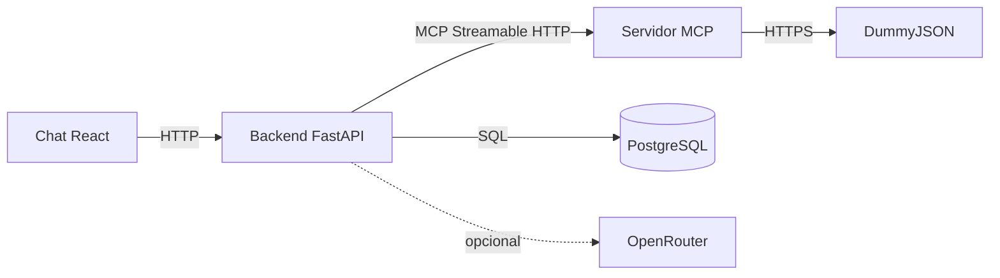

# Agente de Compras MCP

Aplicação demonstrativa que transforma um pedido em linguagem natural em uma requisição de compra baseada em catálogo, com itens, quantidades e valores persistidos.

## Executar localmente

Requisitos: Docker e Docker Compose.

```bash
cp .env.example .env
```

Edite `.env` e defina `POSTGRES_PASSWORD` para um valor local. O modo padrão é `AGENT_MODE=local`, sem chave de LLM.

```bash
docker compose up --build
```

Abra <http://localhost:5173>. A API fica em <http://localhost:8000>; o servidor MCP é interno à rede do Compose. Para encerrar, use `Ctrl+C`; acrescente `-d` para executar em background e `docker compose down` para parar os serviços.

As tabelas são criadas automaticamente pelo backend na inicialização. O volume `postgres_data` preserva os dados entre reinicializações. Para uma demonstração limpa, `docker compose down -v` remove esse volume e os dados locais.

## Configuração

| Variável | Uso | Padrão |
|---|---|---|
| `POSTGRES_DB` | Nome do banco | `purchase_agent` |
| `POSTGRES_USER` | Usuário do banco | `purchase_agent` |
| `POSTGRES_PASSWORD` | Senha local do banco | Obrigatória em `.env` |
| `MCP_SERVER_URL` | Endereço interno do servidor MCP | `http://mcp-server:8001` |
| `AGENT_MODE` | Adaptador do agente: `local`, `openrouter` ou `openai` | `local` |
| `OPENROUTER_API_KEY` | Chave do provedor no modo OpenRouter | Vazia |
| `OPENROUTER_MODEL` | Modelo com suporte a tool-calling | Vazio |
| `OPENAI_API_KEY` | Chave da API OpenAI quando `AGENT_MODE=openai` | Vazia |
| `OPENAI_MODEL` | Modelo OpenAI com suporte a tool-calling | `gpt-4.1-nano` |
| `VITE_API_BASE_URL` | URL da API vista pelo navegador | `http://localhost:8000` |

O modo `local` permite desenvolver e demonstrar o fluxo sem credencial de LLM; sua seleção de produto é determinística e não representa decisão de um modelo. Para tool-calling real pela OpenAI, configure `AGENT_MODE=openai`, `OPENAI_API_KEY` e `OPENAI_MODEL` no `.env`. Para OpenRouter, use `AGENT_MODE=openrouter`, `OPENROUTER_API_KEY` e `OPENROUTER_MODEL`. Nunca coloque credenciais no frontend ou em arquivos versionados. `.env` e o PDF do enunciado são ignorados pelo Git.

## O que a aplicação faz

- O chat envia pedidos para `POST /requisicoes` e apresenta a resposta estruturada.
- O backend consulta o catálogo somente pelo protocolo MCP.
- As ferramentas MCP `buscar_produtos` e `detalhar_produto` consultam a API de demonstração DummyJSON.
- O backend valida os produtos selecionados, aplica o teto unitário informado, recalcula os valores e persiste requisição e itens numa transação.
- `GET /requisicoes` lista as requisições registradas.
- Falhas de catálogo, entradas inválidas e ausência de produto compatível recebem respostas distintas; uma compra inválida não é persistida.

## Testes

Os testes das ferramentas MCP usam HTTP simulado e não requerem chave de LLM nem chamadas reais ao catálogo:

```bash
docker compose exec -T mcp-server python -m pytest -q
```

Os testes de integração do backend também funcionam sem credenciais de LLM:

```bash
docker compose exec -T backend python -m pytest -q
```

## Arquitetura



O servidor MCP é acessível ao backend pela rede privada do Compose. O navegador conversa apenas com o frontend e a API. O OpenRouter é opcional e só participa quando está configurado explicitamente.

## Estrutura do repositório

### Código e ambiente

| Caminho | Conteúdo |
|---|---|
| `compose.yaml` | Serviços, rede, dependências saudáveis, variáveis, healthchecks e volume do PostgreSQL. |
| `.env.example` | Modelo de configuração local, sem credenciais utilizáveis. Copie para `.env`. |
| `.gitignore` | Exclui o PDF do case e arquivos `.env` locais; permite versionar `.env.example`. |
| `backend/Dockerfile` | Imagem Python do backend e comando de inicialização FastAPI. |
| `backend/requirements.txt` | Dependências Python do backend e seus testes. |
| `backend/app/main.py` | API de requisições, criação idempotente das tabelas, validação, persistência transacional e endpoint de saúde. |
| `backend/app/mcp_client.py` | Cliente MCP Streamable HTTP com allowlist, validação local de argumentos e tratamento de falhas. |
| `backend/app/agent.py` | Interface do agente e adaptadores local e OpenRouter, incluindo loop limitado de tool-calling. |
| `backend/tests/test_requisicoes.py` | Testes de integração da criação/listagem, incompatibilidade e ausência de persistência parcial. |
| `mcp-server/Dockerfile` | Imagem Python do servidor de ferramentas MCP. |
| `mcp-server/requirements.txt` | Dependências do servidor MCP e testes. |
| `mcp-server/app/main.py` | Tools de busca e detalhe, normalização do catálogo e limites de timeout. |
| `mcp-server/app/__init__.py` | Marca o diretório da aplicação como pacote Python. |
| `mcp-server/tests/test_catalog_tools.py` | Testes das tools MCP com respostas HTTP simuladas. |
| `frontend/Dockerfile` | Imagem Node para servir a aplicação React durante desenvolvimento local. |
| `frontend/package.json` | Metadados e dependências/scripts do frontend. |

### Documentação de produto, arquitetura e design

| Caminho | Conteúdo |
|---|---|
| `docs/PRD.md` | Problema, público, requisitos, histórias e critérios de sucesso do MVP. |
| `docs/architecture/STACK.md` | Tecnologias, topologia local, configuração e trade-offs. |
| `docs/architecture/AGENTE-COMPRAS-ARCH.md` | Entidades, contrato HTTP/MCP, ciclo do agente, validações e falhas. |
| `docs/designs/DESIGN.md` | Direção visual, tokens, layout, estados, responsividade e acessibilidade. |

### Planejamento SDD e histórico de entrega

| Caminho | Conteúdo |
|---|---|
| `CICLO-01-FUNDACAO-MCP-Tasks.md` | Índice do ciclo de Compose, servidor MCP e testes. |
| `CICLO-02-BACKEND-AGENTE-Tasks.md` | Índice do ciclo de persistência, agente e API. |
| `CICLO-03-ENTREGA-Tasks.md` | Índice do ciclo de interface, README, testes e revisão final. |
| `CICLO-04-DIFERENCIAIS-Tasks.md` | Planejamento dos opcionais: telemetria de tools no chat, script de avaliação, CI e tool de gravação MCP. |
| `docs/stories/ciclo-01-fundacao-mcp/` | Stories e logs de execução da fundação e do servidor MCP. |
| `docs/stories/ciclo-02-backend-agente/` | Stories e logs de execução do banco, agente e API. |
| `docs/stories/ciclo-03-entrega/` | Stories e logs de execução da interface e preparação da entrega. |
| `docs/stories/ciclo-04-diferenciais/` | Quatro stories detalhadas dos diferenciais opcionais; a tool de gravação tem gate arquitetural e de segurança antes da implementação. |

Os logs das stories registram o que mudou, decisões tomadas e evidências de validação. O Git complementa esses registros com commits pequenos e mensagens descritivas.

## SDD aplicado neste projeto

SDD significa **Specification-Driven Development**: primeiro registramos o que construir e por quê; depois detalhamos como as partes se conectam; então planejamos o trabalho em ciclos aprovados, implementamos e validamos cada entrega. Neste repositório, o fluxo está materializado em:

1. PRD de produto com problema, requisitos e critérios de sucesso.
2. Especificação de arquitetura com contratos, dados, erros e limites.
3. Especificação visual antes da interface.
4. Stories pequenas com dependências, critérios verificáveis e logs.
5. Implementação em commits rastreáveis, seguida por testes e revisão.

Ferramentas de IA apoiaram planejamento, implementação e revisão sob supervisão humana; os documentos, testes e commits registram as decisões e resultados verificáveis.

## Próximo ciclo

O plano proposto para o Ciclo 04 e suas stories estão em [`CICLO-04-DIFERENCIAIS-Tasks.md`](CICLO-04-DIFERENCIAIS-Tasks.md); permanece sujeito à aprovação de Rafael.

## API principal

### `POST /requisicoes`

```json
{
  "pedido": "Preciso de 3 laptops para o time de vendas, até US$ 2.000 cada."
}
```

Em sucesso, retorna `201` com número da requisição, itens, preço unitário, total e justificativa. Erros seguem o formato `{"erro":{"codigo":"...","mensagem":"..."}}`.

### `GET /requisicoes`

Retorna as requisições salvas em ordem decrescente de criação.

## Limites conhecidos

- O modo local usa regras determinísticas simples para permitir desenvolvimento sem provedor de LLM.
- O catálogo DummyJSON é dado de demonstração, não estoque ou preço comercial garantido.
- Não há login, aprovação, ERP, pagamento ou disponibilidade real de produtos.
